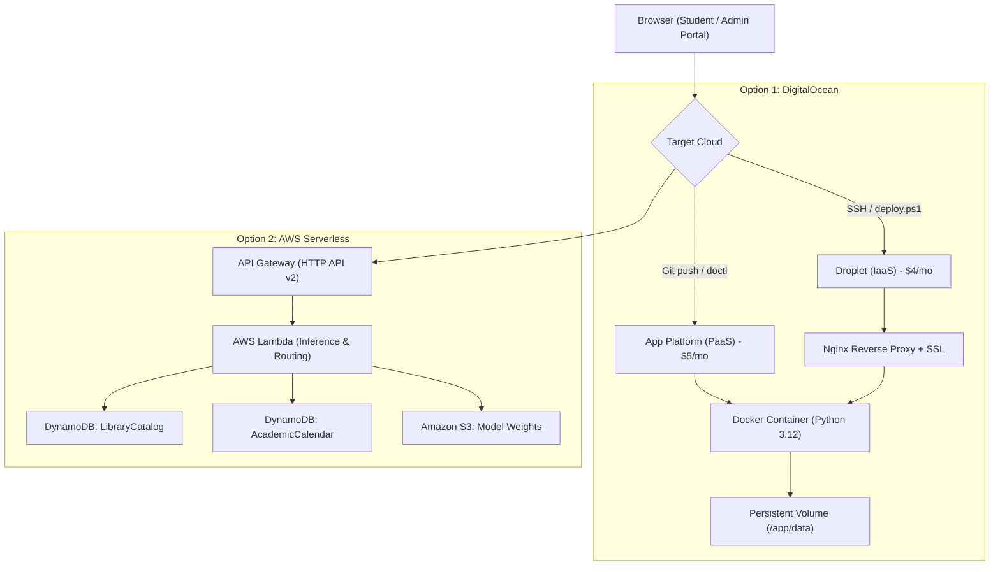

# Real-Time ML Library Book Availability Prediction & Stockout Warning

An end-to-end machine learning and cloud system designed to forecast 7-day student book demand, project physical inventory burn rates, and provide early shortage warnings driven by an **authoritative, administrator-managed university academic calendar**.

> **Borrowing Policy Notice**: The library borrowing policy strictly remains **First-Come, First-Served (FCFS)**. Predictive availability forecasts assist student study planning; they do not alter borrowing rights or create reservation priority.

---

## 1. Quickstart & Local Environment Setup

The system runs out-of-the-box using Python 3.12+ with NumPy and pandas.

### A. Set Up Local Python Virtual Environment (`.venv`)

**On Windows (PowerShell):**
```powershell
# 1. Create the virtual environment
python -m venv .venv

# 2. Allow script execution in current session (if restricted)
Set-ExecutionPolicy -Scope Process -ExecutionPolicy Bypass

# 3. Activate the virtual environment
.\.venv\Scripts\Activate.ps1

# 4. Install dependencies
pip install -r requirements.txt
```

**On Linux / macOS:**
```bash
# 1. Create the virtual environment
python3 -m venv .venv

# 2. Activate
source .venv/bin/activate

# 3. Install dependencies
pip install -r requirements.txt
```

---

### B. Launch Local Web Portal & REST API:
```bash
python app/api.py
```
Open **[http://127.0.0.1:8000](http://127.0.0.1:8000)** in your browser:
- **Student Book Search & Prediction Portal**: `http://127.0.0.1:8000/`
- **Staff Admin Circulation Console**: `http://127.0.0.1:8000/admin` (Default Key: `library-admin-secret-key-2026`)
- **System Health & Metadata**: `http://127.0.0.1:8000/api/health`

---

### C. Run the Comprehensive Test Suite (64 Tests):
```bash
python -m unittest discover tests
```

---

### D. Run the End-to-End Walkthrough Demo:
```bash
python demo.py
```

---

## 2. Authoritative Academic Calendar & Automatic Countdown

- **No Student-Controlled Days-to-Exam**: The manual student-facing countdown input has been **completely removed**. The backend automatically queries the official academic calendar localized to `Asia/Kolkata`.
- **Automatic Exam Status Detection**:
  - `UPCOMING`: Calculates exact calendar days until start date (`(start_date - today).days`).
  - `IN_PROGRESS`: If `start_date <= today <= end_date`, represented as `Exam in progress` (0 days remaining).
  - `NO_EXAM_SCHEDULED`: If no scheduled exams exist, returns `No upcoming exam scheduled` and forecasts standard non-exam baseline demand without artificial exam rush inflation.
- **Admin-Managed Calendar Portal**:
  - Secure endpoints (`X-Admin-Key` header) allow university administrators to create, edit date ranges, correct schedules, and cancel/deactivate exams.
  - Changes immediately update ML inference countdowns across all student requests **without retraining the model**.

---

## 3. Key Engineering Achievements & Repaired Pipeline

1. **Repaired Data Truncation**:
   - The actual original `training_data.csv` was previously truncated at `2026-01-10` due to memory exhaustion during 12.5M row DataFrame concatenation.
   - Re-engineered [`ml/build_training_data.py`](file:///ml/build_training_data.py) using dense 2D matrix representations ($\approx 50$ MB RAM) and chronological block streaming, successfully generating the untruncated **12,569,830 rows** spanning `2023-01-08` through `2026-08-29`.
2. **Strict Time-Window Verification**:
   - Features at date $t$ strictly use historical transactions through $t-1$.
   - Target strictly sums future checkouts on days $t+1$ through $t+7$ (excluding $t$).
   - Incomplete target windows after `2026-08-29` are dropped.
3. **Exam Calendar Alignment**:
   - Formally validated against 23 academic exam cycles.
   - Identified that **CAT-2 drives 54.4% of all borrowing traffic**, with 56.3% of checkouts occurring within 14 days of an exam.
4. **Multiple Linear Regression from Scratch**:
   - Implemented ordinary least squares via NumPy `lstsq` with numerical stability (no explicit matrix inversion).
   - Saved 27 feature coefficients, category mappings, and training cutoff metadata in [`model/regression_model.npz`](file:///model/regression_model.npz).
5. **Rigorous Chronological Holdout**:
   - Trained on dates before `2026-01-01` (10,292,139 rows).
   - Evaluated on held-out year 2026 (2,277,691 rows).

---

## 4. Fair Baseline Comparison (Held-Out Test Period)

All models and baselines evaluated on identical **2,277,691** held-out rows (date $\ge$ 2026-01-01):

| Model / Baseline | MAE | RMSE | $R^2$ |
| :--- | :---: | :---: | :---: |
| **1. Always Predict Zero** | **0.013130** | 0.117035 | -0.012747 |
| **2. Historical Average Baseline (0.0198)** | 0.032378 | 0.116485 | -0.003246 |
| **3. Multiple Linear Regression (Raw OLS)** | 0.035112 | 0.116339 | -0.000737 |
| **4. Linear Regression (Clipped $\ge 0$)** | 0.033468 | **0.116241** | **+0.000942** |

### Critical ML Diagnostic Findings:
- **Zero-Inflation Reality**: 98.71% of test rows have 0 checkouts. The zero baseline wins overall MAE (0.01313) simply by predicting 0 everywhere, but is completely useless as an early warning system.
- **Superiority on Active Borrowing**: On rows where students actually borrow books (29,283 rows), Multiple Linear Regression achieves **MAE = 0.9897**, substantially outperforming the Zero Baseline (MAE = 1.0213).
- **OLS Limitation**: Standard linear regression predicts flat baseline decimals ($\approx 0.024$) due to mean shrinkage. A two-stage **Hurdle / Zero-Inflated Poisson model** is the justified next step.

---

## 5. Cloud Architecture & Deployment Guide

This project can be deployed seamlessly to either **DigitalOcean** or **Amazon Web Services (AWS)**.



---

### A. Deploying to DigitalOcean

See the full guide in [`digitalocean/README.md`](file:///digitalocean/README.md).

#### Method 1: DigitalOcean App Platform (PaaS — Recommended, Zero Maintenance)
1. Push this repository to GitHub or GitLab:
   ```bash
   git push -u origin main
   ```
2. Open the [DigitalOcean Apps Console](https://cloud.digitalocean.com/apps) and click **Create App**.
3. Select your GitHub repository (`Library-Book-Availability-Prediction`).
4. DigitalOcean automatically detects [`.do/app.yaml`](file:///.do/app.yaml) and [`Dockerfile`](file:///Dockerfile).
5. Choose region **Bangalore (`blr`)** (ideal for `Asia/Kolkata` academic timezone) and tier **Basic-xxs (\$5.00/mo)**.
6. Click **Create Resources**. The application builds and deploys with free SSL in 2–3 minutes.

*Alternatively, deploy via CLI:*
```powershell
# Windows DryRun check (zero charges)
powershell -ExecutionPolicy Bypass -File .\digitalocean\deploy.ps1 -DryRun

# Deploy live using doctl CLI
powershell -ExecutionPolicy Bypass -File .\digitalocean\deploy.ps1 -Method AppPlatform
```

#### Method 2: DigitalOcean Droplet (IaaS — Docker Compose + Nginx + Persistent SSD)
1. In DigitalOcean Console, create an **Ubuntu 22.04/24.04 LTS Droplet** (\$4 to \$6/mo, Basic, BLR1 region).
2. Note your Droplet IP (e.g. `159.65.x.x`).
3. Deploy automatically from your local machine:
   ```powershell
   powershell -ExecutionPolicy Bypass -File .\digitalocean\deploy.ps1 -Method Droplet -DropletIp <YOUR_DROPLET_IP>
   ```
   *(Or on Linux/macOS: `./digitalocean/deploy.sh --method Droplet --droplet-ip <YOUR_DROPLET_IP>`)*
4. To attach a custom domain and free Let's Encrypt SSL:
   ```bash
   ssh root@<YOUR_DROPLET_IP>
   certbot --nginx -d library.yourinstitution.edu
   ```

#### Method 3: DigitalOcean Spaces (S3-Compatible Object Storage)
Backup ML models and live database JSON snapshots to DigitalOcean Spaces:
```bash
export DO_SPACES_KEY="your-spaces-key"
export DO_SPACES_SECRET="your-spaces-secret"
export DO_SPACES_REGION="blr1"
export DO_SPACES_BUCKET="your-library-bucket"
python digitalocean/spaces_storage.py
```

---

### B. Deploying to Amazon Web Services (AWS Serverless)

See the full guide in [`docs/aws_deployment.md`](file:///docs/aws_deployment.md).

#### Architecture Components:
- **AWS Lambda**: Multi-threaded serverless compute running [`aws/lambda_function.py`](file:///aws/lambda_function.py).
- **Amazon API Gateway (HTTP API v2)**: Low-latency REST endpoints for public student access and protected admin routes.
- **Amazon DynamoDB**:
  - `LibraryCatalog-dev`: Fast key-value book inventory states and stock records.
  - `AcademicCalendar-dev`: Authoritative university examination calendar.
- **Amazon S3**: Versioned model weight storage (`model/v1/regression_model.npz`).
- **AWS CloudFormation**: Automated Infrastructure-as-Code via [`aws/cloudformation_template.yaml`](file:///aws/cloudformation_template.yaml).

#### Deployment Steps:
1. **Configure AWS Credentials**:
   ```bash
   aws configure
   ```
2. **Dry Run (Validate CloudFormation template without creating resources)**:
   ```powershell
   powershell -ExecutionPolicy Bypass -File .\aws\deploy.ps1 -DryRun
   ```
3. **Live Deployment**:
   ```powershell
   powershell -ExecutionPolicy Bypass -File .\aws\deploy.ps1 -Environment dev -Region ap-south-1 -StackName LibraryAvailability-dev -S3Bucket your-s3-bucket-name
   ```
4. **Seed DynamoDB Catalog**:
   ```bash
   python aws/dynamodb_setup.py
   ```
5. **Local AWS Cloud Proxy (Optional)**:
   Test the local web portal while proxying all backend API requests directly to live AWS Lambda:
   ```bash
   python run_aws_dashboard.py
   ```

---

## 6. Repository Structure

```
Library-Book-Availability-Prediction/
├── .do/
│   └── app.yaml                  # DigitalOcean App Platform specification (Git-Ops)
├── .dockerignore                 # Excludes 1.03GB training data & dev files from Docker build
├── Dockerfile                    # Production multi-stage lean container (Python 3.12-slim)
├── docker-compose.yml            # Container orchestration with persistent ./data volume
├── .gitignore                    # Git exclusions (blocks .venv, 1GB dataset, cache files)
├── requirements.txt              # Core package manifest (NumPy, pandas)
├── README.md                     # Master documentation
├── demo.py                       # Self-contained walkthrough demo script
├── demo_live_movement.py         # 14-day rolling movement simulation demo
├── run_aws_dashboard.py          # Local dashboard proxy to live AWS API Gateway
├── app/
│   ├── api.py                   # Multi-threaded HTTP API server & static frontend host
│   └── static/                  # Responsive web applications
│       ├── index.html            # Student availability search & countdown portal
│       ├── admin.html            # Staff circulation & exam calendar console
│       ├── css/                  # Institutional UI stylesheets (student, admin, common)
│       └── js/                   # Frontend controllers (student.js, admin.js, config.js)
├── digitalocean/
│   ├── README.md                 # Complete DigitalOcean deployment & operations guide
│   ├── app.yaml                  # App Platform specification copy
│   ├── setup_droplet.sh          # One-click Ubuntu Droplet automated setup script
│   ├── nginx.conf                # Production reverse proxy, gzip, and security headers
│   ├── deploy.ps1                # Windows PowerShell deployment script (with -DryRun)
│   ├── deploy.sh                 # Linux/macOS Bash deployment script
│   ├── digitalocean-service.service # Systemd service unit for running without Docker
│   └── spaces_storage.py         # S3-compatible DigitalOcean Spaces backup utility
├── aws/
│   ├── cloudformation_template.yaml # CloudFormation: DynamoDB, S3, IAM, Lambda, API Gateway
│   ├── deploy.ps1                # PowerShell AWS deployment automation
│   ├── deploy.sh                 # Bash AWS deployment automation
│   ├── dynamodb_setup.py         # DynamoDB catalog state loader
│   ├── lambda_function.py        # Cloud Lambda handler with calendar routes
│   └── sample_requests.json      # Sample API Gateway test events
├── ml/
│   ├── academic_calendar.py      # Authoritative academic calendar engine (CRUD + countdown)
│   ├── live_inventory_manager.py # Atomic inventory decrement/increment & loan management
│   ├── stockout_estimator.py     # 7-day demand forecasting & stockout warning engine
│   ├── build_training_data.py    # Memory-safe chunked dataset generator (12.5M rows)
│   ├── train_regression.py       # NumPy lstsq OLS linear regression from scratch
│   └── compare_models.py         # Chronological baseline evaluator (2.27M test rows)
├── model/
│   └── regression_model.npz      # Trained NumPy model weights & category mappings (6.5 KB)
├── data/
│   ├── raw/                      # Catalog CSVs (books.csv, transactions.csv)
│   ├── processed/                # Local training data folder (.gitkeep)
│   ├── academic_calendar.json    # Local academic exam schedule
│   ├── live_inventory.json       # Real-time book copy counts
│   ├── live_loans.json           # Active student loan records
│   └── live_transactions.json    # Transaction audit history
├── docs/
│   ├── architecture.md           # System architectural breakdown
│   ├── aws_deployment.md         # Dedicated AWS serverless guide
│   ├── dataset_report.md         # Data pipeline audit & sparsity metrics
│   └── model_evaluation.md       # Evaluation metrics & diagnostic analysis
└── tests/
    ├── test_academic_calendar.py # Unit tests for calendar CRUD & countdown logic
    ├── test_api.py               # Unit tests for HTTP endpoints & Lambda input validation
    ├── test_aws_dynamodb_mode.py # Tests for DynamoDB conditional writes & S3 fallback
    ├── test_borrow_return_workflows.py # Integration tests for borrowing & returns
    ├── test_data_pipeline.py     # Unit tests for rolling window math
    ├── test_live_movement.py     # Unit tests for 1d, 3d, 7d rolling checkout counts
    ├── test_model.py             # Unit tests for OLS weights & predictions
    ├── test_redesign_server.py   # Integration tests for server routes & static assets
    └── test_stockout.py          # Unit tests for stockout bounds & FCFS policy
```
